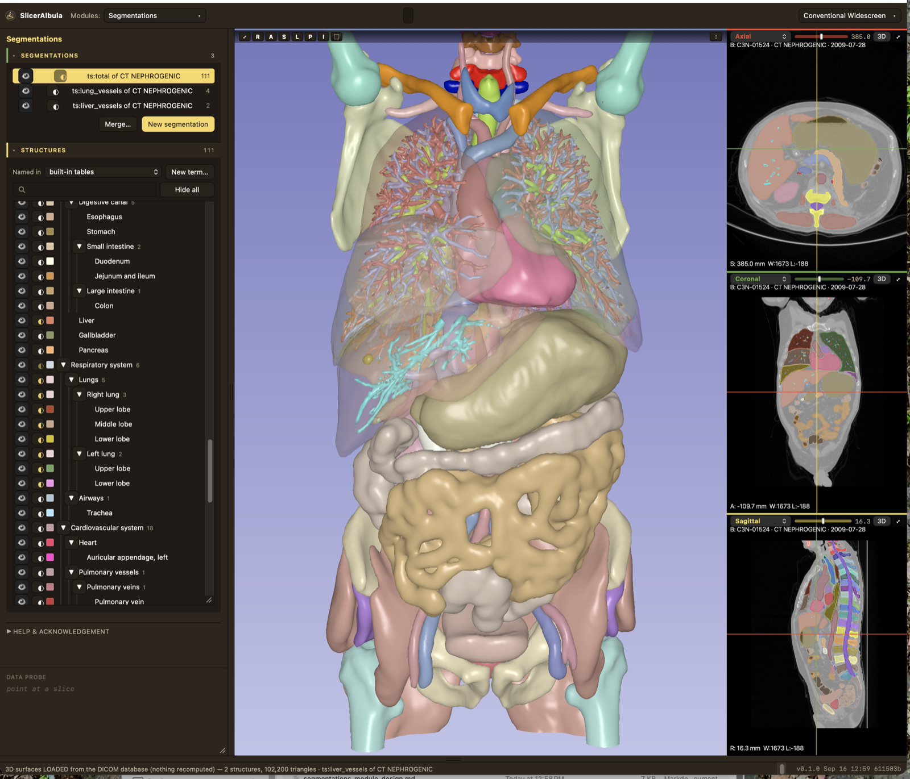
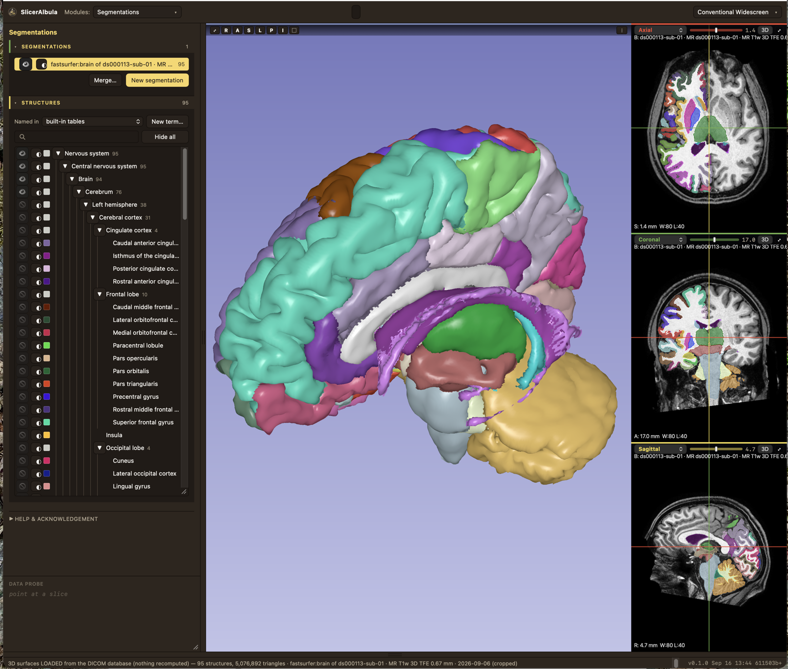

# SlicerAlbula

⚠️ **EXPERIMENTAL & AI-ASSISTED** — This is an early-stage research project deliberately written with AI-assisted coding. Expect rapid change, incomplete features, and rough edges. Use at your own risk in production.

> ## This software is not intended for clinical use.
> ## SlicerAlbula is NOT an FDA approved medical device.

  
  

Left: TotalSegmentator on a whole-body CT (CPTAC case C3N-01524, from the Imaging Data Commons), 111 structures with the lung and liver vessels. Right: FastSurfer on a T1 MR (OpenNeuro ds000113), 95 structures. Both through haversack; the trees are the Segmentations module.

## What this is

SlicerAlbula is my sandbox. I want to experiment on how to improve the user experience. I am
leveraging my decades of experience, which I put into writing in 2014 in
[Ron's Rules for Tools](Contents/docs/RULES-FOR-TOOLS.md).

SlicerAlbula is work in progress, living out the "publish early, publish often" concept. It
leverages the efforts of other people, including [3D Slicer](https://github.com/Slicer/Slicer#readme),
[SlicerLive](https://github.com/pieper/SlicerLive#readme) by Steve Pieper and
[haversack](https://github.com/mhalle/haversack#readme) by Michael Halle.

## What it does today

- A 3D Slicer-style DICOM database browser, with changes to the defaults: derived series are
  nested under the series they came from, the text shown is the text you need, and there is a
  reader and writer for a DICOM-compliant round trip of surfaces.
- Databases made and filled from the app itself: a folder of DICOM files, a disc, or a scene
  packaged on another Mac (a folder ending in `.albula`) goes in with one step. The databases
  keep 3D Slicer's layout, so Slicer opens them too.
- GPU-accelerated versions of more than 70 trained AI segmentation networks, through the
  haversack platform.
- 2D viewers of grayscale images with overlays of the segmentations. A 3D viewer with GPU
  accelerated volume rendering; segmented anatomy is drawn solid straight from the labels, as an
  atlas illustration or realistic, with no surface extraction. The picture quality is the
  user's choice and does not change while you look.
- Custom hierarchical organization of anatomical structures, compliant with
  [TA2](https://ta2viewer.openanatomy.org/).
- A crop box with handles in all viewers, aligned to the volume's own axes. The cropped
  volume goes back into the DICOM database as a derived series, with its provenance recorded.
- Time series: a gated cardiac CT plays as a beating heart, and its segmentations follow the
  phases.
- Diffusion MRI for brain tumor planning, as a separate extension
  ([albula-diffusion](https://github.com/rkikinis/albula-diffusion)): FA and Color FA, two-tensor
  tractography on the graphics card, tract names (TractCloud), and the named tracts near a tumor.
- Experimental: the 3D view in VITURE XR glasses, in stereo and following the head. VITURE's
  own software is needed for it and is not included.

## Installation

The application will be distributed as a signed, notarized DMG under Releases: drag it to
Applications and open it. It needs a Mac with Apple silicon and plenty of memory — a whole-body
case has peaked at 11.7 GB.

AI segmentation runs through haversack. When it is not running, the AI Segmentations module
starts it with one button; that needs [uv](https://docs.astral.sh/uv/) on the Mac.

**Where the source stands (October 2026):** the application is a branch of Steve Pieper's
SlicerLive. Its current state is public as a single snapshot commit, branch
[`albula` of rkikinis/SlicerLive](https://github.com/rkikinis/SlicerLive/tree/albula), updated
from time to time rather than with every change; the diffusion extension is
[rkikinis/albula-diffusion](https://github.com/rkikinis/albula-diffusion), and the data model it
rests on is [SlicerAlbula-core](https://github.com/rkikinis/SlicerAlbula-core).
`Contents/src/live` (Steve Pieper's gallery, unchanged) is a submodule of this repository. A
recipe for building the whole application from these repositories has not been tested from
scratch yet; until it has, the DMG is the way in. The tools are [deno](https://deno.land), at
exactly the version the source names (the build refuses another), and uv.

There is no data in this repository. Albula's Sample Data module downloads public examples
(3D Slicer's sample data, and a healthy volunteer's brain MRI with diffusion from OpenNeuro),
and "Get the brain tumor test cases" brings in the
[OpenNeuro ds001226](https://openneuro.org/datasets/ds001226) brain tumor cases. The CT test
cases come from the [Imaging Data Commons](https://portal.imaging.datacommons.cancer.gov);
[`Contents/data/README.md`](Contents/data/README.md) lists them, and `Contents/data/fetch-idc.py`
downloads them.

## What it is built on

- **[haversack](https://github.com/mhalle/haversack)**, Michael Halle. One command in front
  of every segmentation network. Nothing here wraps a network itself.
- **[SlicerLive](https://github.com/pieper/SlicerLive)** and **[live](https://github.com/pieper/live)**,
  Steve Pieper. The renderer and the application shell. Albula is a branch of his work.
- **[3D Slicer](https://slicer.org)**. The DICOM database layout, dcmqi, and the toolchain this
  interoperates with.
- **[Deno](https://deno.land)**. The application's own server, with the SQLite built into it
  for the database index.
- **[duckn](https://github.com/mhalle/duckn)**, Michael Halle, for the lossless DICOM–zarr
  round trip. The structure tree follows his [Open Anatomy Browser](https://www.openanatomy.org/).
- TotalSegmentator and the other networks, each cited with its paper inside the AI module.
  [dcmjs](https://github.com/dcmjs-org/dcmjs) for DICOM in the browser. Terminologia
  Anatomica and SNOMED CT for the names.

## Funding

Most 3D Slicer funding has come from government sources and many of those programs have
ended, so Slicer's funder list is not reproduced here. Current work, including
SlicerAlbula, is supported by NIH grant
[R01 CA310962](https://reporter.nih.gov/search/NqGZkegLQkaxQEbLxCXMdw/project-details/11343589#description).

## The name

The Albula Pass joins the Rhine valley to the Engadin, in Graubünden. It was a mule track in
Roman times — grain and wine going up, cheese, honey and hides coming back — and the bishops
of Chur took a toll on it through the Middle Ages. What prevented the building of a road was never the
summit: it was the gorge below Bergün, first blasted open with gunpowder in 1695; the post road came
in 1866 and the railway in 1903, which goes through the mountain instead and is a World
Heritage Site. That is the pattern I keep meeting: the hard part is rarely where you expect
it. Surface extraction took 118 seconds; the algorithm was fine and one loop in the webview's
JavaScript engine was not. Dates from Wikipedia's article on the
[Albula Pass](https://en.wikipedia.org/wiki/Albula_Pass). The road in the logo leads to
that pass.

## Contributing, license

Open an issue rather than a pull request — [CONTRIBUTING.md](CONTRIBUTING.md) says why.
Apache-2.0, see [LICENSE](LICENSE). Ron Kikinis, 2026.
